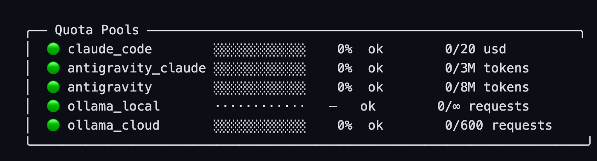
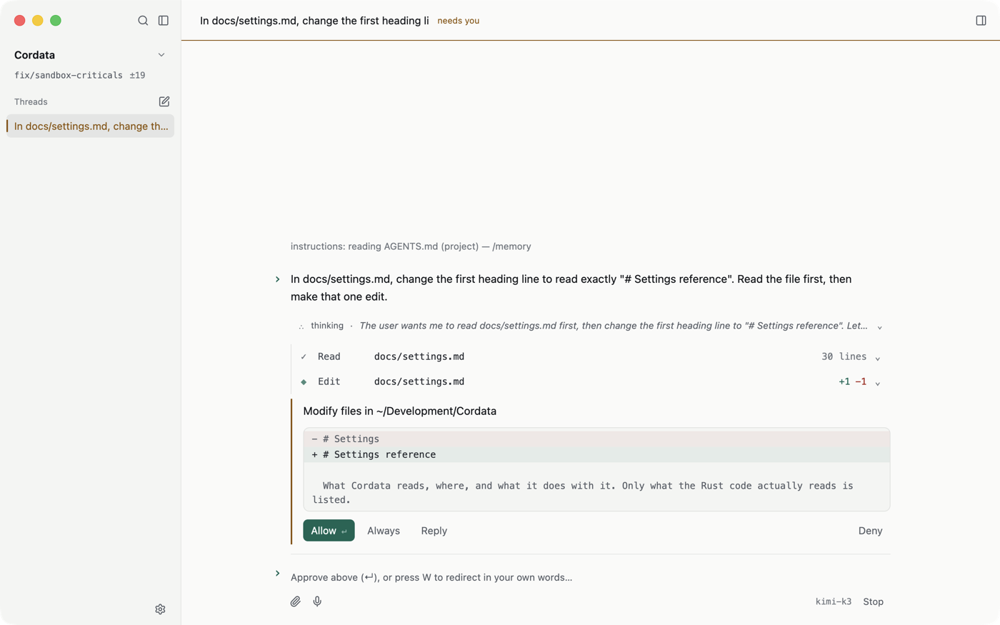
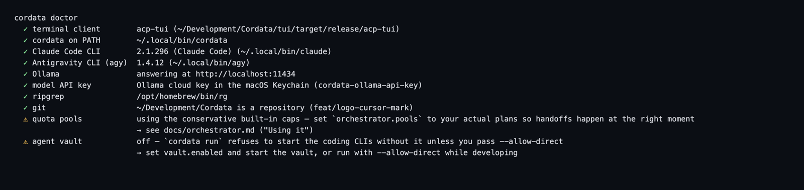

<div align="center">
  <picture>
    <source media="(prefers-color-scheme: dark)" srcset="app/assets/brand/cordata-mark.svg">
    <source media="(prefers-color-scheme: light)" srcset="app/assets/brand/cordata-mark-light.svg">
    
  </picture>
  <h1>Cordata</h1>
</div>

## What is Cordata?

A coding agent for your Mac, in three pieces:

1. **`cordata`** is a chat agent that reads, edits and runs things in your project. It asks before every edit and every command, and runs commands in a macOS sandbox.
2. **`cordata run "goal"`** is an orchestrator. It hands a bigger job to coding CLIs you already have (Claude Code and Antigravity): one model researches and plans, another implements, a model from a different family reviews, and the planner checks the result against its own plan.
3. **Cordata.app** is an optional native window on the same engine: a field of what needs you and what is moving, and a menu bar item to answer safe approvals without opening it.

Everything runs on your machine. The only network calls go to the model providers you configure. It is a single-developer project, macOS only (Apple Silicon for the app), and it changes often.

## What stands out

**One screen for everything running, ranked by what needs you.** The window opens on the *field*: your threads and
orchestrated runs, with only what asks for attention drawn. A blocked command, a working thread, two threads editing the
same component, a thread ready to review. The rest is one line: "7 idle threads". The right rail holds the exact command
waiting on you and the changes ready to review, with the check result. No thread list to hunt through.

**Answer from the menu bar.** Cordata lives there: `C` quiet, `(•` working, `C● 2` when two things wait on you. Its menu
shows the exact command and offers Allow or Reject without opening the window. Risky calls say "Review in Cordata…"
instead, and a click only answers the call the menu showed.

**Several models, checked against each other.** `cordata run` has one model research and plan, another implement, a model
from a different family review, and the planner audit the result against its own plan. Steps of a wave run in
copy-on-write clones of your project with disjoint file scopes, and fold back only what stayed in scope.

**Hold a run, read it, send it on.** When a worker stops (quota line, rate limit, failure, or you) the step moves on with
a handoff packet: how far it got, the checkpoint, the diff, what failed. Hold a run at its next safe point, then resume it
on another worker or with a sentence of your own as direction. A failed run restores your tree to the checkpoint taken
before it started.

**Quota-aware.** Each plan's rolling and weekly quota is metered. When a pool nears its limit, the step continues on
another pool. `cordata status` shows what is left and spends nothing.



**Nothing happens without your say-so.** Every edit and command stops at an approval card with the exact command or diff.
A built-in guard refuses `.env` and `.git/` writes and recursive deletes before the prompt appears, and commands run in a
macOS sandbox. Auto mode lets fixed rules (no model involved) allow the calls they can show are safe and asks about the rest; the guard still applies.



**Keys stay out of files, and setup is one command.** API keys live in the macOS Keychain or your environment, and
`make secrets` fails the build if one lands in the tree. `cordata doctor` says what is installed, which key it found and
the fix for what is missing.



## Quick start

You need macOS, [Rust](https://rustup.rs), Git and [ripgrep](https://github.com/BurntSushi/ripgrep) (`brew install ripgrep`).

```bash
git clone https://github.com/alejandro-sg/Cordata.git cordata && cd cordata
make install                        # builds, links `cordata` into ~/.local/bin, runs `cordata doctor`
make key                            # stores your Anthropic key in the Keychain (hidden prompt)
cd ~/your/project && cordata        # start chatting
```

No Anthropic key? Use Ollama instead: `make key PROVIDER=ollama`, or just run a local Ollama server. Other settings are in [docs/settings.md](docs/settings.md).

For the native window: `make app INSTALL=1` (see [docs/app.md](docs/app.md)).

## Use it

```bash
cordata                                   # chat in the current project; Ctrl+K opens the command deck
cordata "why does the build fail?"        # start with a prompt
cordata run "Add retries to the HTTP client and test them" --allow-direct
cordata show <run_id>                     # a run's plan, who did what, the audit
cordata resume <run_id>                   # continue a paused or interrupted run
```

In the chat prompt: `/` lists commands, `@` attaches a file, `!git status` runs a command and shows the agent its output, `?` shows every key.

`cordata run` needs `--allow-direct` unless you run an Agent Vault proxy (Cordata does not ship one). Without it, the coding CLIs reach the network directly, still inside the Seatbelt sandbox. Set `orchestrator.pools` to your real plans so handoffs happen at the right moment. Details: [docs/orchestrator.md](docs/orchestrator.md).

## Documentation

- [Orchestrator](docs/orchestrator.md): roles, dispatch, quota, handoffs
- [Terminal client](tui/README.md): keys, prompt box, what the chat does not have
- [Native app](docs/app.md): Cordata.app
- [Settings](docs/settings.md): every setting
- [Architecture](ARCHITECTURE.md) · [Threat model](THREAT_MODEL.md) · [Security](SECURITY.md)

## Development

```bash
make tui-test        # terminal workspace tests (offline; no model or key needed)
make app-test        # native app tests
make secrets         # no credential in the tree
```

## License

MIT
